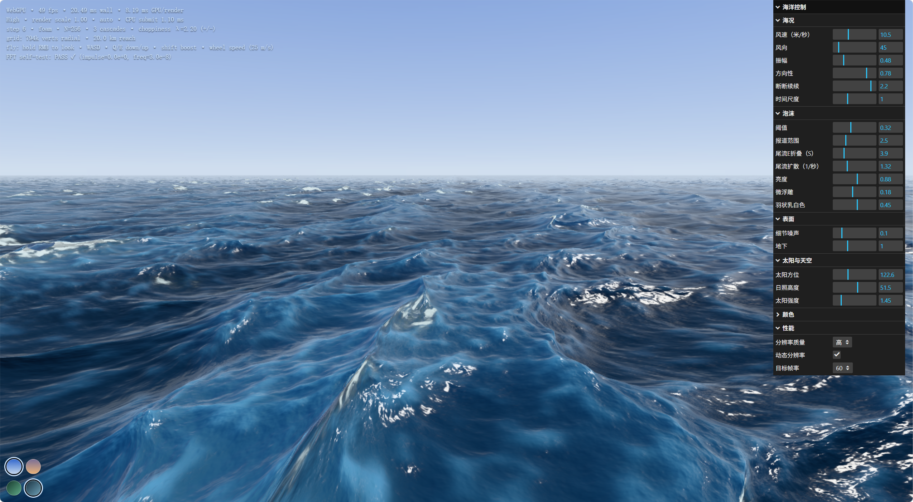
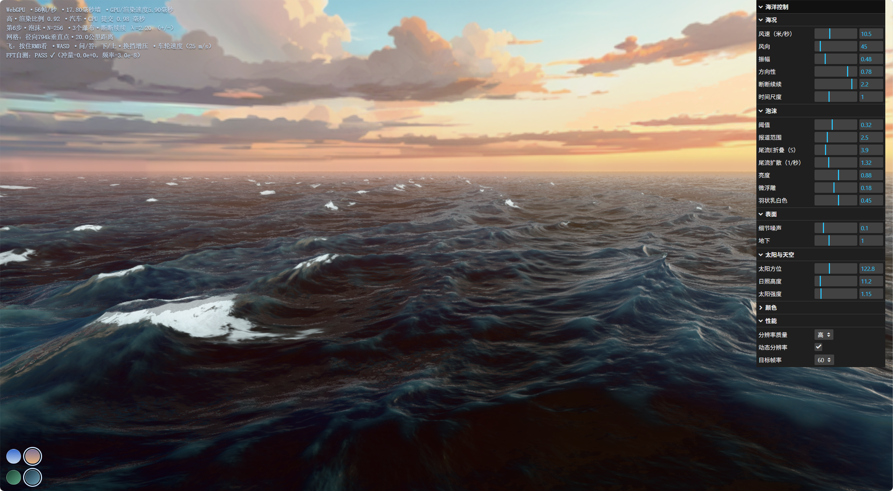
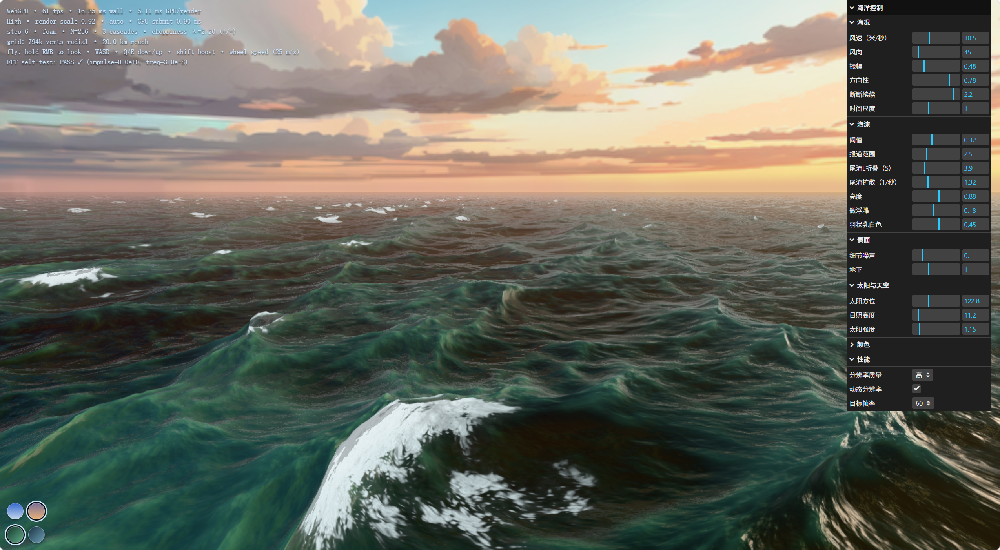

# Poseidon Sea 🌊

基于 [owenyuwono/poseidon](https://github.com/owenyuwono/poseidon) 的实时三维海洋项目，使用 AI 辅助完成 Windows 本地部署与第一阶段性能优化。海浪由 **Three.js + WebGPU + TSL + GPU FFT/IFFT** 实时计算，可自由飞行观察。

## 当前功能

- 三层 FFT 海洋频谱模拟，呈现不同尺度的波浪、浪峰泡沫与太阳高光。
- **793,601 个顶点**的径向网格，跟随相机移动，覆盖半径约 20 公里。
- 实时调节风速、风向、振幅、泡沫和太阳参数。
- 切换正午 / 黄昏天空、深海蓝 / 热带绿海水。
- Low / Medium / High / Ultra 四档渲染分辨率（0.65 / 0.85 / 1.00 / 1.50 倍），支持动态分辨率与 30 / 60 FPS 目标。
- 保留原有 FFT、网格与光学着色算法；增加 CPU 提交耗时显示，并修正低帧率时的 HUD 统计。

当前天空采用原项目的环境贴图。动态云层、完整日夜循环及自动巡航等后续目标尚未实现。目标 60 FPS 不代表所有设备都能稳定达到。

## 运行

需要 Node.js 20.19+（或支持的较新版本）、npm，以及启用 WebGPU 的 Chrome / Edge 和兼容显卡驱动。

```bash
git clone https://github.com/zhihan0704/Poseidon-sea.git
cd Poseidon-sea
npm ci
npm run dev -- --host 127.0.0.1
```

打开 **http://127.0.0.1:5174/**。生产构建使用 `npm run build`，预览使用 `npm run preview`。

Windows 安装依赖后也可双击 `Start-Poseidon.vbs` 启动服务并打开 Edge；脚本使用默认 Node.js / Edge 安装路径，自定义安装位置需相应调整。`Stop-Poseidon.ps1` 用于停止启动器记录的本项目服务。日志和服务状态保存在项目的上一级目录。

| 操作 | 功能 |
|---|---|
| 按住鼠标右键拖动 | 转动视角 |
| W / A / S / D | 自由飞行 |
| Q / E | 下降 / 上升 |
| Shift / 鼠标滚轮 | 加速 / 调整飞行速度 |
| 右侧控制面板 | 海况、光照、泡沫与性能设置 |
| 左下角色块 | 切换天空与海水颜色 |

## 运行截图

以下为实际运行时的用户截图。HUD 中的 49、56、61 FPS 是截图瞬时读数，不是统一条件下的平均帧率或稳定性承诺。界面文字可能受浏览器翻译影响。

### 正午 · 深海蓝



### 黄昏 · 深海蓝



### 黄昏 · 热带绿



## AI 提示词

以下是本项目使用的两阶段提示词整理版，描述任务目标，并非全部功能的完成清单。

**部署阶段**

```text
请在 Windows 11 上完整部署并运行官方 Poseidon 项目：
https://github.com/owenyuwono/poseidon
先检查许可证、README、依赖、Node.js、显卡和浏览器 WebGPU 支持，
再克隆项目、按锁文件安装依赖并实际启动验证。
保留 Three.js、WebGPU、TSL、GPU Compute、三层 FFT/IFFT 和径向网格。
禁止以静态图片、视频或简单正弦波替代实时 GPU 海洋。
验证波浪、泡沫、高光、地平线、自由飞行和实时参数面板，
记录实际 FPS、控制台错误和运行截图，不得虚构验收结果。
交付源码、运行说明和可双击启动的 Windows 桌面快捷方式。
```

**视觉与性能优化阶段**

```text
将已运行的 Poseidon 逐阶段提升为更真实的实时海洋系统。
修改前备份源码并记录 Git 状态，保留 WebGPU、FFT、径向网格、
摄像机跟随和现有海况参数，不盲目降低网格精度。
逐步改善波浪层次、风向关系、泡沫生命周期、水面光学和太阳闪烁；
计划增加动态天空、云层、日夜与海况预设、巡航和交互控制。
优先分析 CPU、GPU、FFT、渲染与网格更新的瓶颈，
加入低、中、高、极高画质与合理的动态分辨率，目标稳定 60 FPS。
每次只完成一个阶段，修改后实际启动、检查控制台和 WebGPU/FFT，
测试不同海况，记录 FPS、GPU 耗时并对比截图。
发现问题修复或回滚，未经验证的功能不得标记完成。
```

## 来源与许可

原项目：[owenyuwono/poseidon](https://github.com/owenyuwono/poseidon)，基于提交 `671053b812fcbffe8ecc4668eaa6ab7ffeb63287`。本仓库保留原作者版权与 [MIT LICENSE](LICENSE)，原始说明见 [README.upstream.md](README.upstream.md)。

FFT/频谱技术参考 [gasgiant/FFT-Ocean](https://github.com/gasgiant/FFT-Ocean)。黄昏天空素材来自 [FreeStylized Skybox 131](https://freestylized.com/skybox/sky_131/)，按原项目注明的素材许可使用，独立于代码的 MIT 许可。
